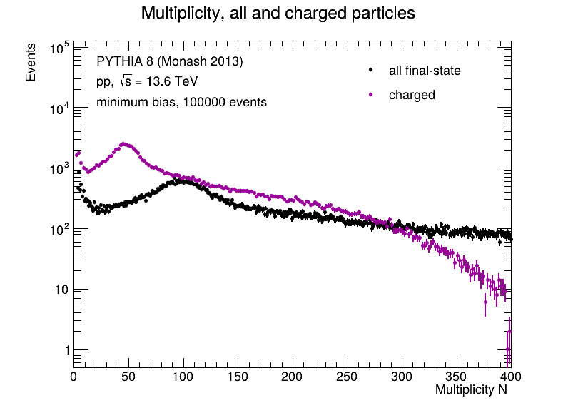
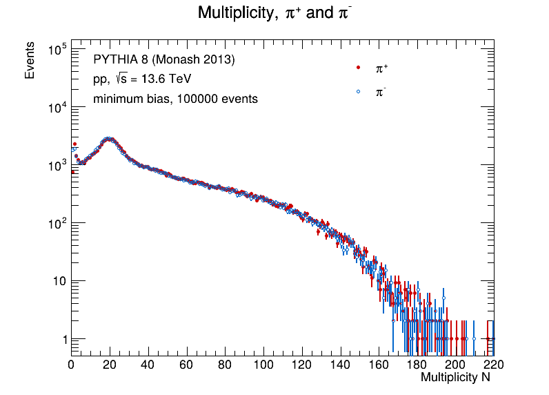
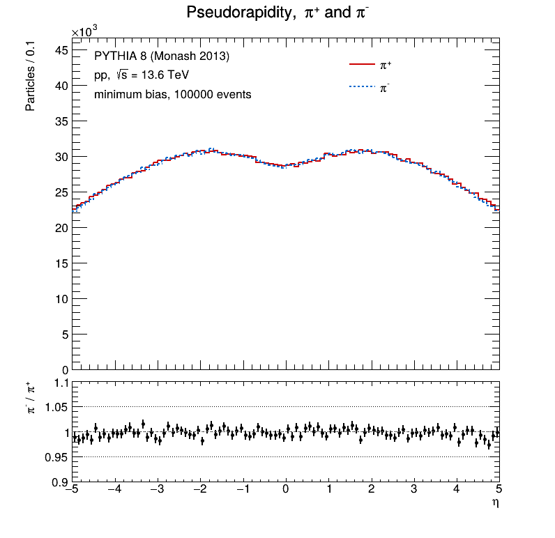
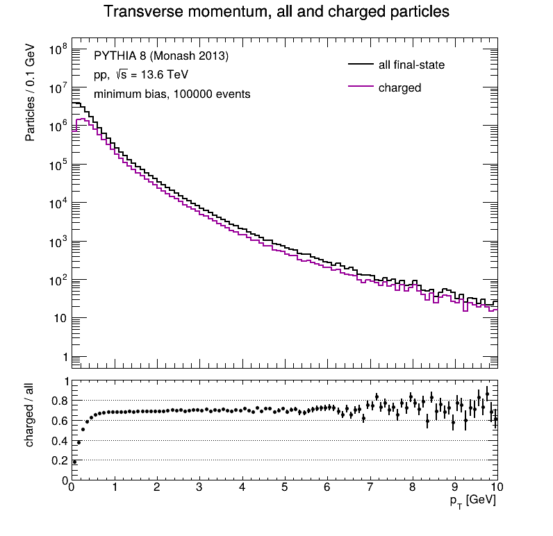
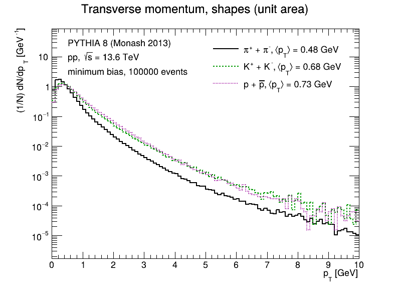
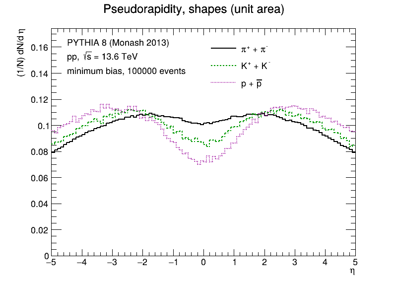
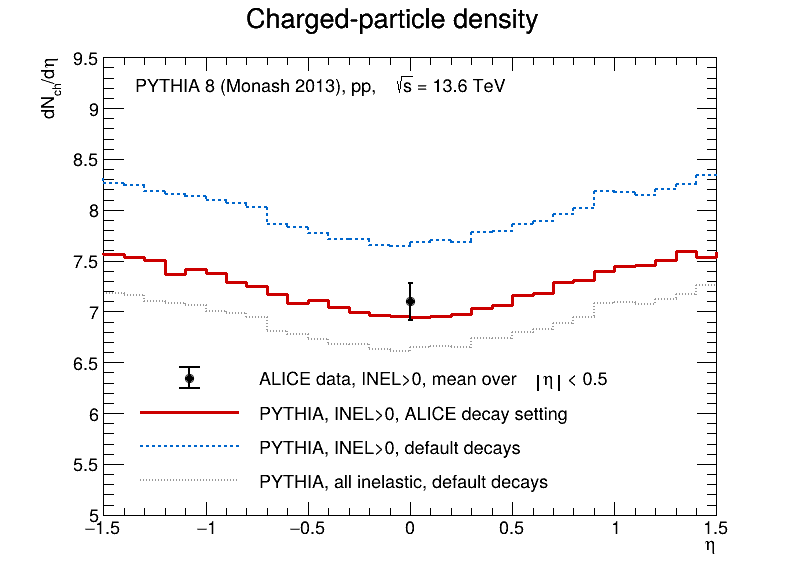

# pp-minbias-13p6tev

**What happens when two protons collide at √s = 13.6 TeV?** This project follows that question from start to finish: Pythia 8 generates 100 000 minimum-bias proton-proton collisions, a C++/ROOT program histograms every final-state particle, and a ROOT macro turns the histograms into plots.
At the end I hold the simulation up against a real measurement by ALICE at the same energy.

Author: Tomasz Stolarczyk

<div align="center">

<table>
  <tr>
    <td></td>
    <td></td>
    <td></td>
  </tr>
  <tr>
    <td></td>
    <td></td>
    <td></td>
  </tr>
</table>

</div>

## Contents

1. [The pipeline in one minute](#1-the-pipeline-in-one-minute)
2. [Quick start](#2-quick-start)
3. [Step by step](#3-step-by-step)
4. [How I read the task](#4-how-i-read-the-task)
5. [Bonus: comparison with an ALICE paper](#5-bonus-comparison-with-an-alice-paper)
6. [Repository layout](#6-repository-layout)
7. [Reproducible by design](#7-reproducible-by-design)
8. [Where I learned from](#8-where-i-learned-from)

## 1. The pipeline in one minute

```
config/minbias.cmnd ──► generate ──► data/events.root ──► analysis ──► results/analysis.root ──► draw_plots.C ──► plots/
   Pythia settings      Pythia 8      final-state tree     C++/ROOT      32 histograms             ROOT macro       PNG + PDF
```

<div align="center">

| Step | Program | What it does |
| --- | --- | --- |
| 1. Generation | [src/generate.cc](src/generate.cc) | Runs Pythia 8 with the settings from [config/minbias.cmnd](config/minbias.cmnd) and stores every final-state particle (`isFinal()`) of every event in a ROOT tree. |
| 2. Analysis | [src/analysis.cc](src/analysis.cc) | Reads the tree and fills multiplicity N, p<sub>T</sub>, η and φ histograms for eight particle categories. |
| 3. Plots | [macros/draw_plots.C](macros/draw_plots.C) | Draws every histogram on its own canvas, plus overlays of two categories with their ratio below. |
| 4. Check | [tests/check_task.C](tests/check_task.C) | Goes through the task text point by point and checks that the outputs satisfy it. |
| Bonus | [macros/compare_alice.C](macros/compare_alice.C) | Compares the charged-particle density with ALICE at the same energy. |

</div>

The plots are in [plots/](plots/). Every run also leaves its log in [results/](results/), so each number quoted here can be traced back:

- [generate.log](results/generate.log): Pythia's changed settings, the first event in full, cross sections and the error statistics (0 events lost out of 100 000)
- [analysis.log](results/analysis.log): particles per category, and the mean, standard deviation, underflow and overflow of every histogram
- [compare_alice.log](results/compare_alice.log) and [generate_alice.log](results/generate_alice.log): the ALICE comparison

[results/analysis.root](results/analysis.root) also stores the Pythia settings it was made with, as the text object `generator_settings`.

## 2. Quick start

### Requirements

- ROOT 6
- Pythia 8
- C++17 compiler
- CMake 3.18 or newer

Tested on Ubuntu 22.04 LTS with ROOT 6.40.04, Pythia 8.318, CMake 4.4.5 and GCC 12.3.
Identical histograms are expected only with the same Pythia version and settings.

### Setup

**ROOT:** follow [root.cern/install](https://root.cern/install/). Check the C++ standard of your build with `root-config --cflags`; it should contain `-std=c++17`.

**Pythia:** download the source from [pythia.org](https://pythia.org/) and build it with C++17 (its default is C++11):

```bash
./configure --prefix=$HOME/pythia8 \
    --cxx-common='-O2 -std=c++17 -pedantic -W -Wall -Wshadow -fPIC -pthread'
make -j4 && make install
```

In every new shell, before building or running:

```bash
source <root-install-dir>/bin/thisroot.sh   # not needed if ROOT comes from a package manager
export PATH=$HOME/pythia8/bin:$PATH
```

### One command to run the whole pipeline

```bash
scripts/run_all.sh
```

It builds the programs, runs every step below, checks the result against the task and then runs the ALICE comparison. It takes about 4 minutes on the test machine (2 of them for the task itself) and overwrites `data/`, `results/` and `plots/`.

## 3. Step by step

### Build

```bash
cmake -S . -B build
cmake --build build
```

### Generation

```bash
mkdir -p data results
./build/generate config/minbias.cmnd data/events.root | tee results/generate.log
```

All settings, including the number of events, the random seed and the model tune
(Monash 2013, Pythia's default), live in [config/minbias.cmnd](config/minbias.cmnd). The output is a tree `events` with one entry per event and the branches `pdg`, `charge`, `pt` (GeV), `eta` and `phi` (rad), each holding
one value per final-state particle. Intermediate particles never reach the file. The tree (about 470 MB) is not in the repository; the command above recreates it.

### Analysis

```bash
./build/analysis data/events.root results/analysis.root | tee results/analysis.log
```

[results/analysis.root](results/analysis.root) holds the 32 histograms `hN_<cat>`,
`hPt_<cat>`, `hEta_<cat>` and `hPhi_<cat>`. The multiplicity is filled once per event, also
when it is zero; p<sub>T</sub>, η and φ once per particle.

<div align="center">

<table>
<tr>
<td valign="top">

| Category | Selection |
| --- | --- |
| `all` | every final-state particle, including neutral ones |
| `ch` | charge ≠ 0 |
| `pip`, `pim` | π⁺, π⁻ (PDG ±211) |
| `Kp`, `Km` | K⁺, K⁻ (PDG ±321) |
| `p`, `pbar` | p, p̄ (PDG ±2212) |

</td>
<td valign="top">

| Histogram | Bins | Range |
| --- | --- | --- |
| `hN` | 400 | [0, 400] |
| `hPt` | 100 | [0, 10] GeV |
| `hEta` | 100 | [−5, 5] |
| `hPhi` | 64 | [−π, π] |

</td>
</tr>
</table>

</div>

### Plots

```bash
root -l -b -q 'macros/draw_plots.C("results/analysis.root", "plots")'
```

- [plots/histograms_single/](plots/histograms_single/): each of the 32 histograms on its own canvas, with the full range from the task and a statistics box (entries, mean, standard deviation, underflow, overflow).
- [plots/histograms_overlay/](plots/histograms_overlay/): all vs charged, π⁺ vs π⁻, K⁺ vs K⁻ and p vs p̄ for each variable, with the ratio of the two below (16 plots), and the shapes of the p<sub>T</sub> and η distributions of π, K and p (2 plots).

The number of charged particles is always even, because the two protons bring a total charge of +2. Every odd bin of `hN_ch` is therefore empty. I draw the multiplicities as points, so this stays visible, instead of merging the bins in pairs and hiding it.

### Results at a glance

<div align="center">

| Category | ⟨N⟩ per event | ⟨p<sub>T</sub>⟩ [GeV] | outside \|η\| < 5 |
| --- | --- | --- | --- |
| all | 192.66 | 0.40 | 25.7% |
| charged | 92.06 | 0.51 | 26.8% |
| π⁺ / π⁻ | 38.36 / 37.71 | 0.48 / 0.48 | 26.1% / 25.0% |
| K⁺ / K⁻ | 4.24 / 4.12 | 0.68 / 0.68 | 27.7% / 26.0% |
| p / p̄ | 3.82 / 2.60 | 0.69 / 0.78 | 50.3% / 29.0% |

</div>

One number per histogram type: the mean of `hN` (particles per collision), the mean of `hPt`, and the share of particles that `hEta` keeps in its underflow and overflow. The φ distributions are flat, so their mean is 0 for every category and is left out. The means include the values outside the histogram ranges; every number is in [results/analysis.log](results/analysis.log).

### Check

```bash
root -l -b -q tests/check_task.C
```

[tests/check_task.C](tests/check_task.C) reads the task text point by point and checks the outputs against it; `scripts/run_all.sh` runs it after the plots:

<div align="center">

| Task | What is checked |
| --- | --- |
| Technical requirements | the build used `-std=c++17`, ROOT major version 6, Pythia version 8 |
| 1) Generation | pp beams, `Beams:eCM = 13600`, SoftQCD on, 100 000 events, total charge +2 in every event (only final-state particles in the tree) |
| 2), 3) Histograms | all 32 names, each binning and range, one `hN` entry per event, every φ inside [−π, π], each category holds exactly its particles (charge ≠ 0, PDG ±211, ±321, ±2212) |
| 4) Macro | opens `analysis.root`, uses the required axis labels and legends, every plot exists as PNG and PDF |

</div>

## 4. How I read the task

A few points of the task leave room for interpretation. Here is what I chose and why.

**Minimum bias.** "Minimum bias (SoftQCD)" does not name a single Pythia switch. I use `SoftQCD:inelastic`: every inelastic collision (non-diffractive and diffractive), without elastic scattering, which produces no new particles. ALICE's own simulation software uses the same switch for minimum-bias pp collisions ([pythia8_inel.cfg](https://github.com/AliceO2Group/AliceO2/blob/dev/Generators/share/egconfig/pythia8_inel.cfg)). Switching is one line in the `.cmnd` file.

**Decays and "final state".** I take the task literally: a particle is analysed if Pythia's `isFinal()` says so, with Pythia's default decays. This means that K⁰<sub>S</sub> and Λ decay and their daughters count as final-state particles. When comparing with ALICE
I found that their setup keeps these longer-lived particles undecayed, so the comparison has its own configuration (see the [bonus section](#5-bonus-comparison-with-an-alice-paper)); the histograms of the task stay as the task asks.

**φ range.** The task text gives 0–π for the φ histogram, while Pythia gives φ in (−π, π]. The task author, dr hab. Małgorzata Janik, clarified that this was a mistake in the text and that the histogram should cover the full range from −π to π. `hPhi` therefore spans [−π, π] and keeps the 64 bins from the task.

**`all` and `ch`.** The task lists "all charged particles" but names both `hN_all` and `hN_ch`. I read `all` as every final-state particle, neutral ones included, and `ch` as the charged ones.

**Nothing is thrown away.** I apply no kinematic cuts. Values outside a histogram range
go to its underflow or overflow bin and count in the mean and standard deviation, so the statistics box shows the true values. The ranges from the task cut off a lot: 12.7% of the events have N<sub>all</sub> ≥ 400, and 27% of the charged particles have |η| > 5. [results/analysis.log](results/analysis.log) lists everything outside the ranges for each histogram.

## 5. Bonus: comparison with an ALICE paper

A simulation is a model, and a model is only as good as its agreement with nature. So once the task was done, I wanted to see how my collisions compare with real ones, measured by ALICE at the same energy.

**Finding the right paper.** Searching arXiv for ALICE papers with 13.6 TeV in the title gives four:

- *Measurement of prompt and non-prompt D\*⁺-meson spin alignment in pp collisions at √s = 13.6 TeV* ([arXiv:2609.39713](https://arxiv.org/abs/2609.39713))
- *Measurement of the B⁰-meson production cross section in proton–proton collisions at √s = 13.6 TeV* ([arXiv:2603.18904](https://arxiv.org/abs/2603.18904))
- *Time resolution of the ALICE Time-Of-Flight detector with the first Run 3 pp collisions at √s = 13.6 TeV* ([arXiv:2511.10311](https://arxiv.org/abs/2511.10311))
- *Inclusive and multiplicity-dependent pseudorapidity densities of charged particles in pp collisions at √s = 13.6 TeV* ([arXiv:2602.10658](https://arxiv.org/abs/2602.10658))

Only the last one is about the same particles I histogram for the task: it measures the
η distribution of charged particles per collision and per unit of η, the charged-particle
density dN<sub>ch</sub>/dη. That is my `hEta_ch`, divided by the number of events and the
bin width. So that is the paper I compare with.

**Counting the way ALICE counts.** A fair comparison needs the same definitions, so I tuned a second run of the model to match theirs:

- **Events:** the paper reports INEL>0 collisions, which have at least one charged particle in |η| < 1. 
I apply the same selection to my events.
- **Decays:** ALICE's own Pythia configuration ([pythia8_inel.cfg](https://github.com/AliceO2Group/AliceO2/blob/dev/Generators/share/egconfig/pythia8_inel.cfg)) lets only particles with cτ₀ < 10 mm decay, so K⁰<sub>S</sub>, Λ and similar particles stay undecayed. My comparison run does the same ([config/minbias_alice.cmnd](config/minbias_alice.cmnd)). It removes about 10% of the π⁺ and 20% of the protons, their decay products, and leaves the kaons untouched.

**One definition at a time.** The plot below is my version of Fig. 1 of the paper. I switched the definitions on one by one: the grey curve is the task run, the blue one keeps only INEL>0 events, and the red one also uses the ALICE decay setting. Averaged over |η| < 0.5 they give 6.68, 7.71 and 7.00, against 7.10 ± 0.18 measured by ALICE ([results/compare_alice.log](results/compare_alice.log)). The data as a function of η are published only as a figure, so the measurement appears as its average over |η| < 0.5.

<p align="center">
  
</p>

With matched definitions PYTHIA agrees with the measurement within its uncertainty (ratio 0.987).

**Multiplicity classes.** ALICE also sorts the collisions by how many particles hit its forward detector FT0 and measures the density in each class (Table 2 of the paper). I did the same with my comparison run, counting the charged particles in the FT0 acceptance (3.5 < η < 4.9 and −3.3 < η < −2.1):

<div align="center">

| class (%) | data | PYTHIA (ALICE) | PYTHIA (ours) | ours / data |
| --- | --- | --- | --- | --- |
| 0–1 | 21.78 ± 0.38 | 25.50 | 25.96 | 1.19 |
| 1–5 | 18.48 ± 0.25 | 20.71 | 20.91 | 1.13 |
| 5–10 | 15.76 ± 0.22 | 17.19 | 17.44 | 1.11 |
| 10–15 | 13.89 ± 0.19 | 14.71 | 14.66 | 1.06 |
| 15–20 | 12.50 ± 0.17 | 12.62 | 12.58 | 1.01 |
| 20–30 | 10.86 ± 0.15 | 10.02 | 10.10 | 0.93 |
| 30–40 | 9.09 ± 0.13 | 7.51 | 7.60 | 0.84 |
| 40–50 | 7.63 ± 0.11 | 5.60 | 5.64 | 0.74 |
| 50–70 | 5.87 ± 0.09 | 3.72 | 3.76 | 0.64 |
| 70–100 | 3.69 ± 0.06 | 2.47 | 2.49 | 0.68 |
| **0–100** | **7.10 ± 0.18** | **7.11** | **7.00** | **0.99** |

</div>

⟨dN<sub>ch</sub>/dη⟩ in |η| < 0.5, INEL>0. The classes, the data and PYTHIA (ALICE, version
8.311) are from Table 2 of the paper; PYTHIA (ours, version 8.318) is from
[results/compare_alice.log](results/compare_alice.log), where my events are split at the
INEL>0 percentiles that the same table lists for each class.

My PYTHIA reproduces the PYTHIA values computed by ALICE within 2% in every class. And the model, which gets the average right, misses the extremes: it puts too many particles into the busiest collisions and too few into the quietest ones, as the paper also concludes.

ALICE has not published identified-particle spectra at 13.6 TeV yet. I hope that will change soon, and I would be glad to help with that :)

## 6. Repository layout

```
config/       Pythia settings: the task run and the ALICE comparison run
src/          generate.cc and analysis.cc (compiled with CMake)
macros/       draw_plots.C and compare_alice.C (ROOT macros)
tests/        check_task.C
scripts/      run_all.sh
results/      analysis.root and the log of every run
plots/        histograms_single/, histograms_overlay/, alice_comparison/
presentation/ slides.pdf with all plots, built from slides.tex (pdflatex, twice)
```

## 7. Reproducible by design

The task asks for a reproducible production, so the whole repository is built around it:

- **One command.** `scripts/run_all.sh` builds the programs and runs every step in order:
  generation, analysis, plots, the check against the task and the ALICE comparison. It
  stops at the first failing step.
- **Fixed seed.** The random seed is set in [config/minbias.cmnd](config/minbias.cmnd),
  together with every other setting, so the same Pythia version gives the same events.
- **The settings travel with the results.** `analysis.root` stores the Pythia version and
  every changed setting, in a form Pythia can read back.
- **Every log is in the repository.** [results/](results/) keeps the output of every run,
  so each number in this README and in the presentation can be traced back.
- **Checked, not assumed.** Running `scripts/run_all.sh` again, also in a fresh clone of
  this repository, gives bin-for-bin identical histograms.

## 8. Where I learned from

Pythia
- [Pythia 8.3 worksheet](https://pythia8.web.cern.ch/materials/pdf/worksheet8312.pdf): my first steps with Pythia
- [Pythia 8.318 online manual](https://pythia8.web.cern.ch/manuals/pythia8318/Welcome.html): the manual I followed
- [A comprehensive guide to the physics and usage of PYTHIA 8.3](https://pythia8.web.cern.ch/manuals/pdfdoc/pythia8300.pdf): the physics behind Pythia

ROOT
- [Getting started](https://root.cern/learn/): my first steps with ROOT
- [User manual](https://root.cern/manual/): the manual I followed
- [Reference guide 6.40](https://root.cern/doc/v640/): the full class documentation

ALICE
- [arXiv:2602.10658](https://arxiv.org/abs/2602.10658): ALICE Collaboration, the paper I compare with
- [AliceO2 Pythia configuration](https://github.com/AliceO2Group/AliceO2/blob/dev/Generators/share/egconfig/pythia8_inel.cfg): how ALICE sets up Pythia for minimum-bias pp

## License
This project is licensed under the terms of the MIT license. See the [LICENSE](LICENSE) file for details.
